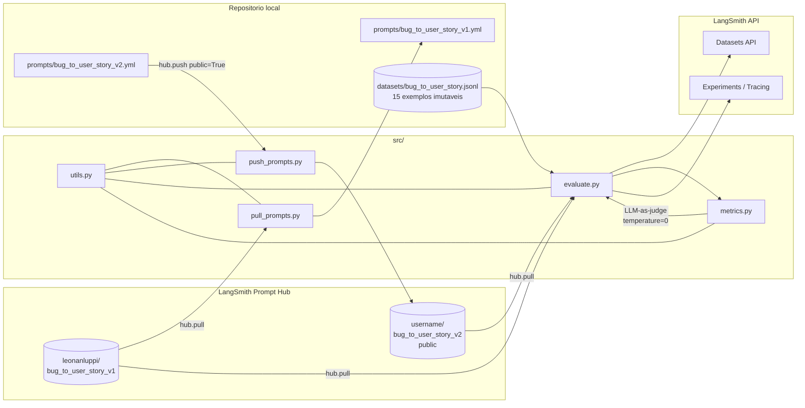
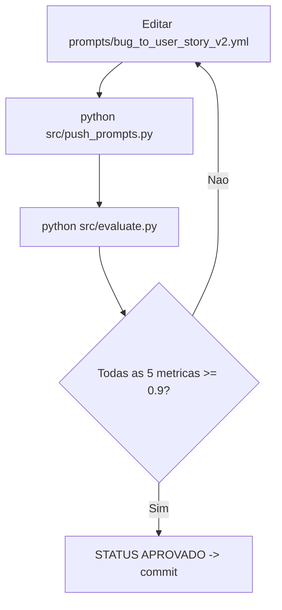

# ARCHITECTURE — Pull, Otimização e Avaliação de Prompts (LangSmith Prompt Hub)

> Documento derivado estritamente de `SPEC.md`. Não há RAG, banco vetorial, Docker ou ingestão de PDFs neste projeto. Trata-se de um pipeline Python (venv) que baixa, otimiza, publica e avalia prompts no LangSmith Prompt Hub.

---

## 1. Visão de componentes

### 1.1 Diagrama de fluxo (Mermaid)



### 1.2 Diagrama de iteração (ciclo do engenheiro de prompt — US-06)



---

## 2. Modulos (responsabilidades, contratos, dependencias)

Todos os modulos vivem em `src/` e compartilham `utils.py` para configuracao. Nenhum modulo implementa logica de negocio fora do escopo do SPEC.

### 2.1 `src/utils.py` (RF-07)
Centraliza infraestrutura compartilhada.

| Funcao | Entrada | Saida | Observacao |
|---|---|---|---|
| `load_yaml(path)` | str | dict ou None | parser PyYAML, encoding utf-8 |
| `save_yaml(data, path)` | dict, str | bool | cria diretorios, `sort_keys=False`, `allow_unicode=True` |
| `check_env_vars(required)` | list[str] | bool | aborta com mensagem se faltar variavel |
| `get_llm(model=None, temperature=0)` | str?, float | ChatOpenAI \| ChatGoogleGenerativeAI | provider via `LLM_PROVIDER`; usa `OPENAI_RESPONSE_MODEL` ou `GEMINI_MODEL` |
| `get_eval_llm(temperature=0)` | float | LLM | usa `OPENAI_EVAL_MODEL` (gpt-4o) ou `GEMINI_MODEL` |
| `format_score(score, threshold=0.9)` | float, float | str | render visual no stdout |
| `print_section_header(title)` | str | None | UX terminal |

Dependencias: `python-dotenv`, `pyyaml`, `langchain-openai`, `langchain-google-genai`.

### 2.2 `src/pull_prompts.py` (RF-01, US-01)
- **Entrada:** env vars `LANGSMITH_API_KEY`.
- **Acao:** `hub.pull("leonanluppi/bug_to_user_story_v1")` -> serializa o `ChatPromptTemplate` para `prompts/bug_to_user_story_v1.yml`.
- **Saida:** arquivo YAML local + log `Pull OK: leonanluppi/bug_to_user_story_v1`.
- **Idempotencia:** sobrescreve o arquivo com o conteudo canonico do Hub (RNF-03).
- **Contrato YAML:** representacao equivalente a `ChatPromptTemplate.messages` com chaves `system` / `user`.

### 2.3 `src/push_prompts.py` (RF-03, US-03)
- **Entrada:** `prompts/bug_to_user_story_v2.yml`, env `LANGSMITH_API_KEY`, `LANGSMITH_USERNAME`.
- **Acao:** carrega YAML, reconstroi `ChatPromptTemplate`, valida estrutura minima (system, user, ausencia de `TODO`/`FIXME`), e executa `hub.push("{username}/bug_to_user_story_v2", prompt, public=True)`.
- **Saida:** stdout com a URL publica `https://smith.langchain.com/hub/{username}/bug_to_user_story_v2`.
- **Idempotencia:** novo push gera nova versao no Hub sem erro (RF-03, US-03 cenario 2).

### 2.4 `src/evaluate.py` (RF-04, US-04)
- **Entrada:** `datasets/bug_to_user_story.jsonl` + prompts v1 e v2 (puxados do Hub).
- **Pipeline:**
  1. `check_env_vars` para o provider escolhido.
  2. `Client()` LangSmith; cria/reutiliza dataset `{LANGSMITH_PROJECT}-eval` a partir dos 15 exemplos.
  3. Para `v1` e `v2`: `hub.pull` -> chain `prompt | get_llm()` -> `invoke` em cada exemplo.
  4. Para cada par (answer, reference), invoca os 5 evaluators de `metrics.py`.
  5. Agrega medias por metrica e imprime tabela com `format_score` + STATUS.
  6. Tracing automatico via `LANGSMITH_TRACING=true`; `experiment_prefix="bug_to_user_story_v1"` e `..._v2` (RNF-04).
- **Saida:** stdout estruturado (Helpfulness, Correctness, F1, Clarity, Precision, STATUS) + experimentos visiveis no LangSmith UI.
- **Exit code:** 0 se v2 APROVADO, !=0 caso contrario (US-04 cenario reprovado).

### 2.5 `src/metrics.py` (RF-05)
Cinco evaluators puros (input -> dict `{score, reasoning, ...}`), todos usando `get_eval_llm(temperature=0)` para reduzir nao-determinismo (R-04):

| Evaluator | Tipo | Assinatura | Score |
|---|---|---|---|
| `evaluate_helpfulness(question, answer, reference)` | LLM-as-judge | retorna `{score, reasoning}` | float [0,1] |
| `evaluate_correctness(question, answer, reference)` | LLM-as-judge | idem | float [0,1] |
| `evaluate_f1_score(question, answer, reference)` | LLM-as-judge calculando precision+recall e fechando F1 (formula 2PR/(P+R)) | `{score, precision, recall, reasoning}` | float [0,1] |
| `evaluate_clarity(question, answer, reference)` | LLM-as-judge | `{score, reasoning}` | float [0,1] |
| `evaluate_precision(question, answer, reference)` | LLM-as-judge | `{score, reasoning}` | float [0,1] |

Todos os prompts de avaliacao instruem o juiz a retornar **JSON puro** (`extract_json_from_response` faz fallback de parsing tolerante a wrapper).

> O scaffold atual contem evaluators extras de dominio (tone, acceptance criteria, format, completeness). Eles podem permanecer como utilitarios internos, porem **apenas as 5 metricas do SPEC sao reportadas** no `evaluate.py` (RF-05).

### 2.6 `tests/test_prompts.py` (RF-06, US-05)
- Apenas leitura local de `prompts/bug_to_user_story_v2.yml` (RNF-07: offline, segundos).
- 6 asserts: system prompt presente, role definida, formato de saida especificado, `>= 2` exemplos few-shot, ausencia de `TODO`/`FIXME`, `>= 2` tecnicas (Few-shot + 1 avancada).

---

## 3. Fluxos de dados

### 3.1 Pull (RF-01)
```
.env -> load_dotenv -> hub.pull("leonanluppi/bug_to_user_story_v1")
       -> ChatPromptTemplate -> serializacao para dict
       -> save_yaml -> prompts/bug_to_user_story_v1.yml
```

### 3.2 Push (RF-03)
```
prompts/bug_to_user_story_v2.yml -> load_yaml -> dict
   -> validate (system/user, sem TODO, >=2 few-shots)
   -> ChatPromptTemplate.from_messages([...])
   -> hub.push("{username}/bug_to_user_story_v2", prompt, public=True)
   -> log da URL publica
```

### 3.3 Evaluate (RF-04, RF-05)
```
datasets/bug_to_user_story.jsonl (15) -> Client.create_dataset (idempotente)
                                       \
v1 (Hub) ----+--> chain = prompt | LLM(temperature=0)  ---->|
v2 (Hub) ----+                                              |--> answer
                                                            |
para cada exemplo: (answer, reference) -> 5 evaluators (LLM-as-judge T=0)
   -> medias por metrica -> STATUS APROVADO/REPROVADO -> exit code
```

### 3.4 Iteracao (US-06)
3 a 5 ciclos manuais: editar v2.yml -> push -> evaluate -> ler scores -> ajustar tecnica/few-shots ate todas as metricas `>= 0.9`.

---

## 4. Decisoes arquiteturais (ADRs curtos)

### ADR-01 — YAML como formato canonico de prompts
- **Status:** Aceita.
- **Contexto:** RF-01/RF-02/RF-03 exigem persistencia local versionada e legivel para iteracao manual (US-06) e testes offline (US-05).
- **Decisao:** Serializar `ChatPromptTemplate` como YAML com listas de mensagens (`system`, `user`) + metadados (`description`, `version`, `techniques_applied`, `few_shot_examples`). PyYAML com `allow_unicode=True` e `sort_keys=False`.
- **Consequencias:** diff legivel em PR, parsing trivial nos testes pytest, conversao trivial para `ChatPromptTemplate.from_messages`.

### ADR-02 — Uso de `langchain.hub` (pull/push) em vez de chamadas REST diretas
- **Status:** Aceita.
- **Contexto:** RNF-01 fixa stack LangChain 0.3.x; SPEC 7.4 referencia o nome literal do prompt.
- **Decisao:** `from langchain import hub; hub.pull(...)` / `hub.push(..., public=True)`. Nada de `requests` direto.
- **Consequencias:** menor superficie de erro, autenticacao via `LANGSMITH_API_KEY` resolvida pela lib, integracao automatica com tracing.

### ADR-03 — Provider LLM selecionavel via `LLM_PROVIDER`
- **Status:** Aceita.
- **Contexto:** US-08 e RNF-06 permitem OpenAI ou Gemini.
- **Decisao:** `utils.get_llm()` decide via env (`openai` -> `ChatOpenAI(gpt-4o-mini)`; `google`/`gemini` -> `ChatGoogleGenerativeAI(gemini-2.5-flash)`). `get_eval_llm()` aplica o modelo de avaliacao (`gpt-4o` ou mesmo Gemini).
- **Consequencias:** zero acoplamento de codigo a um provider; troca via `.env` sem editar fontes.

### ADR-04 — Evaluators custom em `metrics.py` com LLM-as-judge a `temperature=0`
- **Status:** Aceita.
- **Contexto:** RF-05 exige 4 metricas LLM-as-judge + F1; R-04 alerta para nao-determinismo.
- **Decisao:** Cada evaluator monta um prompt instrutivo em PT-BR pedindo JSON estrito; `extract_json_from_response` aplica fallback regex `{...}`. F1 e calculado a partir de `precision` e `recall` retornados pelo juiz (formula `2PR/(P+R)`), e nao por contagem mecanica de tokens — escolha justificada pela natureza semantica das user stories (sinonimos e ordem variavel quebrariam token-overlap puro). Todos rodam com `temperature=0`.
- **Consequencias:** scores reprodutiveis o suficiente para o threshold de 0.9; custo concentrado em `gpt-4o`/`gemini-2.5-flash` durante avaliacao.

### ADR-05 — Dataset imutavel local + replicacao no LangSmith
- **Status:** Aceita.
- **Contexto:** SPEC 4 (Nao-objetivos): `bug_to_user_story.jsonl` nao pode ser alterado. RNF-04 exige experimentos visiveis no UI.
- **Decisao:** `evaluate.py` cria (idempotentemente) um dataset `{LANGSMITH_PROJECT}-eval` no LangSmith com os 15 exemplos do JSONL. Se ja existir, reusa.
- **Consequencias:** experimentos comparaveis no UI; arquivo local permanece fonte da verdade.

### ADR-06 — Sem Docker, sem servico web, sem CLI interativa
- **Status:** Aceita.
- **Contexto:** SPEC 2 (Nao-objetivos) e RNF-01 exigem execucao local em venv.
- **Decisao:** scripts CLI puros (`python src/<x>.py`) + pytest. Configuracao 100% via `.env`.
- **Consequencias:** setup minimo; `requirements.txt` enxuto; reprodutibilidade via Python 3.9+.

---

## 5. Configuracao (variaveis de ambiente)

Conforme SPEC 7.2; papel de cada variavel:

| Variavel | Papel | Usada por |
|---|---|---|
| `LANGSMITH_TRACING` | habilita tracing automatico (`true`) | evaluate (RNF-04) |
| `LANGSMITH_ENDPOINT` | endpoint da API LangSmith | Client global |
| `LANGSMITH_API_KEY` | autenticacao LangSmith | pull, push, evaluate |
| `LANGSMITH_PROJECT` | nome do projeto/experimento | evaluate (prefix) |
| `LANGSMITH_USERNAME` | dono do prompt v2 publicado | push, evaluate (resolve `{username}/bug_to_user_story_v2`) |
| `LLM_PROVIDER` | `openai` ou `gemini` | utils.get_llm |
| `OPENAI_API_KEY` | chave OpenAI | utils.get_llm |
| `OPENAI_RESPONSE_MODEL` | modelo de resposta (default `gpt-4o-mini`) | evaluate |
| `OPENAI_EVAL_MODEL` | modelo do juiz (default `gpt-4o`) | metrics |
| `GOOGLE_API_KEY` | chave Gemini | utils.get_llm |
| `GEMINI_MODEL` | `gemini-2.5-flash` | evaluate + metrics |

> Observacao: o scaffold atual usa nomes alternativos (`LLM_MODEL`, `EVAL_MODEL`, `USERNAME_LANGSMITH_HUB`). O `python-developer` deve alinhar ao SPEC 7.2 (`OPENAI_RESPONSE_MODEL`, `OPENAI_EVAL_MODEL`, `LANGSMITH_USERNAME`) ou aceitar ambos como aliases mantendo retrocompat. Recomendacao: padronizar SPEC e tratar variantes legadas como fallback.

---

## 6. Estrategia de avaliacao

### 6.1 Metricas (RF-05)
- **Helpfulness (LLM-judge, T=0):** "a resposta atende ao objetivo da pergunta de forma util?" — score [0,1].
- **Correctness (LLM-judge, T=0):** "a resposta esta factualmente correta vs. referencia?" — score [0,1].
- **Clarity (LLM-judge, T=0):** organizacao, linguagem, ausencia de ambiguidade, concisao — media de 4 sub-criterios.
- **Precision (LLM-judge, T=0):** ausencia de alucinacoes, foco na pergunta, correcao factual — media de 3 sub-criterios.
- **F1-Score (LLM-judge, T=0):** o juiz estima `precision` e `recall` semanticos; F1 e calculado deterministicamente como `2PR/(P+R)`. **Justificativa:** F1 token-based puro penalizaria sinonimos validos em user stories (ex.: "cliente" vs "comprador"), levando a falsos negativos.

### 6.2 Pipeline por prompt
```
para cada example em dataset (15):
    answer = (prompt_template | response_llm).invoke(inputs)
    f1       = evaluate_f1_score(question, answer, reference)
    clarity  = evaluate_clarity(...)
    precision= evaluate_precision(...)
    helpful  = evaluate_helpfulness(...)
    correct  = evaluate_correctness(...)

medias = mean(...) por metrica
STATUS = APROVADO se todas >= 0.9 senao REPROVADO
```

### 6.3 Threshold (RNF-02)
Todas as 5 metricas devem atingir `>= 0.9` em v2 sobre os 15 exemplos.

### 6.4 Observabilidade (RNF-04)
- `LANGSMITH_TRACING=true` -> cada `invoke` vira run rastreado.
- `experiment_prefix="bug_to_user_story_v1"` e `bug_to_user_story_v2` permitem comparacao lado a lado no UI.

---

## 7. Riscos tecnicos e mitigacao

| ID | Risco | Mitigacao |
|---|---|---|
| R-01 | Rate limit/indisponibilidade LangSmith/OpenAI/Gemini | Try/except com mensagens acionaveis; sleep+retry simples no loop de avaliacao; prever fallback Gemini via `LLM_PROVIDER` |
| R-02 | Custo da avaliacao com `gpt-4o` repetida | Reusar dataset existente (idempotencia); opcao de usar `gemini-2.5-flash` em ambos os papeis (RNF-06); evitar reavaliar v1 a cada ciclo (rodar v1 uma vez, focar v2) |
| R-03 | Nao atingir 0.9 em todas as metricas em poucos ciclos | Orcamento de 5 iteracoes (US-06); diagnostico por metrica no stdout indica onde ajustar (few-shots, role, formato) |
| R-04 | Nao-determinismo do LLM-judge | `temperature=0` em todos os evaluators; prompts de juiz exigem JSON estrito; `extract_json_from_response` tolerante |
| R-05 | Remocao do prompt fonte `leonanluppi/bug_to_user_story_v1` | Pull idempotente preserva copia local em `prompts/bug_to_user_story_v1.yml`; baseline continua avaliavel mesmo offline do Hub |
| R-06 | Divergencia entre nomes de env vars do scaffold e do SPEC | Padronizar via SPEC 7.2; aceitar aliases legados em `utils.py` durante transicao |
| R-07 | Custo por token em prompts de juiz longos (PT-BR detalhado) | Manter prompts de juiz concisos; truncar `answer`/`reference` se ultrapassar limite razoavel |

---

## 8. Mapeamento Requisitos -> Componentes

| RF/RNF/US | Componente |
|---|---|
| RF-01, US-01 | `src/pull_prompts.py`, `utils.save_yaml` |
| RF-02, US-02 | `prompts/bug_to_user_story_v2.yml` (engenharia humana) + `tests/test_prompts.py` |
| RF-03, US-03 | `src/push_prompts.py`, `utils.load_yaml` |
| RF-04, US-04 | `src/evaluate.py` |
| RF-05 | `src/metrics.py` |
| RF-06, US-05 | `tests/test_prompts.py` |
| RF-07 | `src/utils.py` |
| RF-08, US-06 | ciclo manual (push + evaluate) |
| RNF-01 | `requirements.txt` (devops) |
| RNF-02 | thresholds em `evaluate.display_results` |
| RNF-03 | idempotencia em pull/push e create_dataset |
| RNF-04 | `LANGSMITH_TRACING=true`, `experiment_prefix` |
| RNF-05 | `.env` gitignored, `.env.example` documentando chaves |
| RNF-06 | escolha de modelos via env |
| RNF-07 | `tests/` offline, sem rede |
| US-07 | `requirements.txt` + README |
| US-08 | `utils.get_llm` / `get_eval_llm` |
